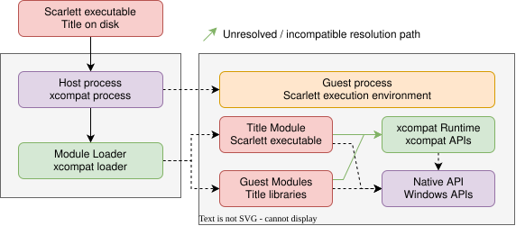

# xcompat

An experimental Xbox Series X|S (Scarlett) compatibility layer for Windows.

The initial prototype already supports guest process creation, PE mapping, relocations,
and import enumeration.

The long-term objective is to reproduce the Scarlett execution environment while
leveraging native Windows and hardware capabilities wherever possible.

Early research prototype. Game execution is not implemented yet.

## Current state

The project is an early loader prototype. It can construct a guest process and prepare a
Scarlett title image, but it does not start the title's initial thread yet.

The loader currently maps the title and its available Windows and packaged dependencies,
then stops when required Scarlett system modules are unavailable. The remaining known
surface is Scarlett-specific imports across several DLLs. Their researched signatures,
behavior, and implementation requirements are tracked in the
[first-glance implementation checklist](./docs/notes/01-first-glance.md).

## Architecture

Since Scarlett binaries are packaged in a PE32+ format, the binaries are relatively
compatible with Windows. This allows xcompat to load the binary in memory space similar
to how Windows loads an executable.

xcompat starts by creating a guest process in Windows and maps the Scarlett executable
into its memory space. The host process is responsible for managing the guest process,
loading modules, applying relocations, and resolving imported symbols.

Where possible, imported symbols are resolved directly to native Windows APIs. The planned
xcompat runtime will provide incompatible or Scarlett-specific interfaces and translate
their platform behavior into equivalent Windows functionality.

Since Scarlett is targeted to run on an x86-64 processor, guest code can execute natively
without CPU emulation. This allows xcompat to focus primarily on compatibility at the
operating system, runtime, and hardware interface levels.

## Development

xcompat is written in modern C++ and builds upon [Hydra](https://github.com/substrant/hydra/tree/reversed-coffee/v2),
a C++23 process manipulation library that I have used in other projects, for low-level systems programming, memory
management, and PE manipulation.

This project is a loader proof of concept. The native loading path is in place through
dependency and import resolution; guest execution and the Scarlett memory, graphics,
storage, and audio services remain unimplemented.

| Component | Status |
|---|---|
| Native NT process creation | Implemented |
| PE32+ image mapping | Implemented |
| Remote process memory access | Implemented |
| Base relocation processing | Implemented |
| Import enumeration | Implemented |
| Dependency loading | Prototype |
| Import resolution | Partial |
| Scarlett runtime | Research |
| Guest execution | Not yet implemented |
| Graphics compatibility | Not yet implemented |

The loader currently prepares the title image and available dependencies inside a dedicated guest process. Unresolved
Scarlett-specific imports are collected to identify the runtime interfaces requiring implementation.

## Disclaimer

xcompat is an independent project and is not affiliated with or endorsed by Microsoft or
Xbox.
