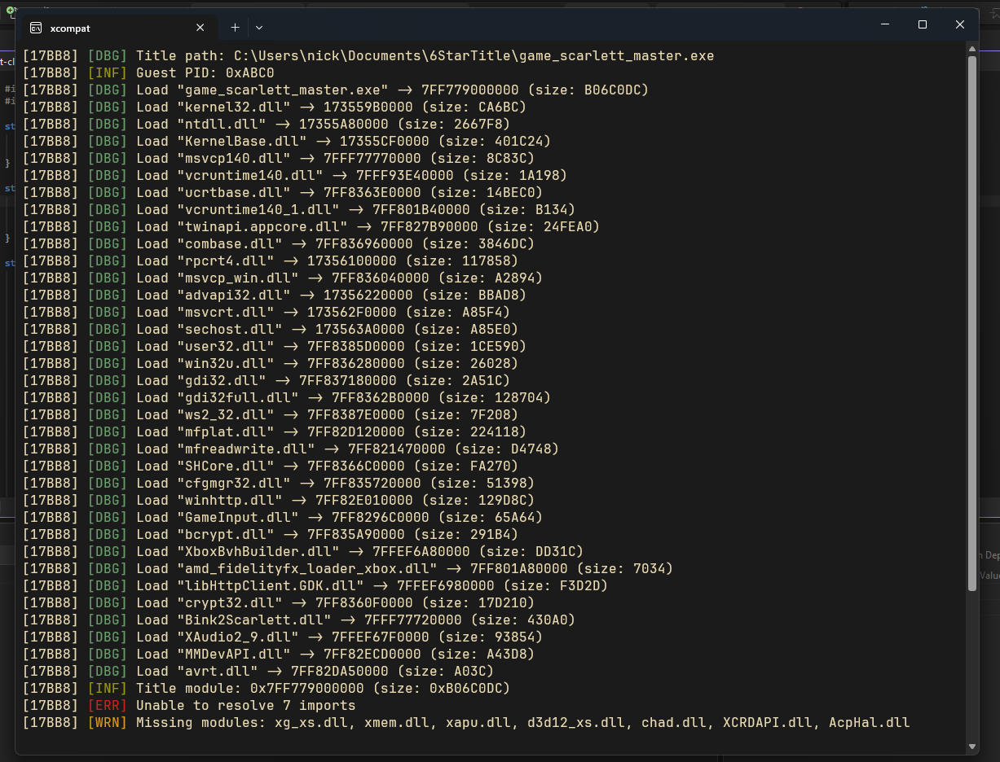

# Devlog #1 - Building the PE Loader

Just finished implementing a good chunk of the part of xcompat that loads the game into
the guest process. 

## PE Loader

Scarlett binaries are (unsurprisingly) relatively compatible with Windows, and I was able
to use the internal `NtCreateSection` and `NtMapViewOfSection` functions to map images
from the disk to the guest process's virtual memory.

The process of setting this up is very similar to setting up a semi-coupled manual mapper
for loading DLLs in usermode processes. If you have worked with PE images, the process is
relatively straightforward, especially when leveraging the NT API.

What's listed here is expected so far. System modules resolve while there exist seven
missing modules. These are Scarlett-specific modules that will need to be implemented in
the xcompat runtime (see [01-first-glance.md](../notes/01-first-glance.md)).

## Experimental Memory Architecture

Outside of the loader, I've been investigating potential approaches to reproducing
Scarlett's unified memory architecture.

The current concern is how to preserve the semantics expected by Scarlett titles on
systems where CPU and GPU memory are physically separate.

## What Everyone Else Does

Existing Scarlett compatibility layers, namely [**XCL**](https://github.com/xcl-dev/xcl)
and [**VIctory**](https://github.com/Marvisak/VIctory), approach the unified memory
problem through different forms of software-managed memory translation.

**XCL** constructs a GPU-visible representation of the title's address space using up to
four 4 GiB memory windows. Translated shaders perform address arithmetic against these
windows, allowing arbitrary memory accesses without requiring the recompiler to determine
the origin of every pointer.

For compatible allocations, **XCL** uses `OpenExistingHeapFromAddress` to expose the same
underlying memory to both processors. Larger reservations use sparse D3D12 resources
backed by VRAM, with CPU modifications tracked and uploaded before GPU execution.

**VIctory** approaches the problem through shadow resources. Rather than maintaining a
GPU-visible representation of the entire title memory space, it creates host resources
as they are required by GPU operations. This reduces upfront memory consumption but
adds complexity in address tracking, synchronization and resource coherency.

## Virtualizing Unified Memory

One approach I thought about is creating a virtualized MMU, using the additional control
over address translation to reproduce aspects of the guest's memory model.

I'm not familiar enough with virtualization to make a definitive call on whether or not
it's possible/worth doing without further research. This would not solve CPU/GPU memory
coherence or physical memory separation, but could provide greater control over guest
memory mappings.

## Hypervisor-Assisted Address Translation

The first approach would involve using hardware-assisted virtualization, specifically
second-level address translation (Intel EPT or AMD NPT), to introduce an additional layer
of translation between guest physical addresses and host physical memory.

This would allow xcompat to maintain its own guest memory model independently of the
host's physical memory layout. Memory accesses requiring special handling could be
intercepted through EPT/NPT violations, while ordinary accesses would continue executing
natively.

The advantage of this approach is that address translation would primarily be performed by
hardware, avoiding the need to instrument individual memory-access instructions.

The main disadvantage is the additional complexity of introducing a hypervisor into what
is otherwise a userspace compatibility layer. GPU memory mappings would also require
separate consideration, as CPU-side address translation does not extend to the GPU's MMU.

## Page Faults

The second approach would involve implementing software-managed address translation using
page faults and low-level user/kernel-mode exception handlers.

By controlling the accessibility of guest memory ranges, accesses requiring translation
could trigger page faults. Instrumentation callbacks could intercept the
kernel-to-user-mode transition during exception dispatch, allowing xcompat to inspect the
execution context and intervene before conventional exception handling takes place.

The handler could then resolve the faulting address, establish the appropriate memory
mapping and resume execution of the original instruction.

Unlike the hypervisor approach, this would operate within the existing NT process model,
utilizing the host's memory manager rather than introducing a separate hardware-assisted
translation layer.

The primary concern is the overhead associated with fault handling, kernel transitions and
changes to virtual memory mappings. Instrumentation callbacks would provide an
interception mechanism, but would not eliminate the underlying cost of page faults.

The feasibility of this approach would largely depend on how frequently mappings need to
change and whether the required memory semantics can be reproduced using NT's existing
virtual memory facilities.

## The Real Bottleneck

Regardless of what implementation you use, since a unified memory model is used, you will
always be bottlenecked by the speed of the PCI bus, and whatever synchronization is
implemented in between. 

This shifts the translation problem more towards handling resource contention and
synchronization in a more robust manner.
