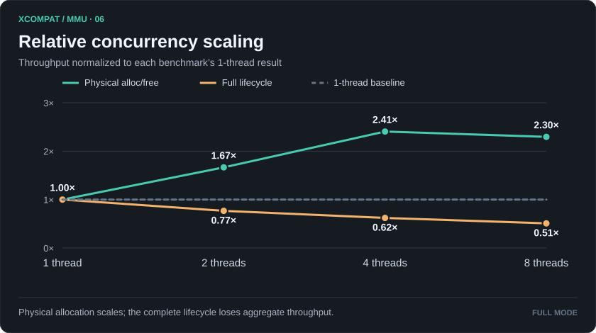
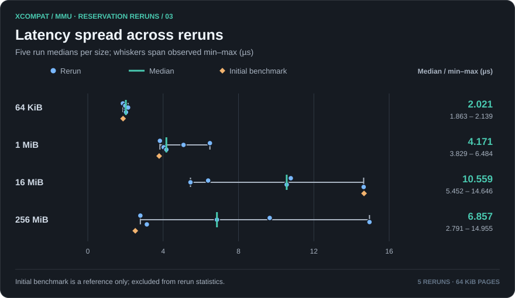

# Devlog #2 - Building the MMU

Since the last devlog, I've been working on implementing `xmem.dll`, and in the process ended up implementing a good
chunk of what will be the memory manager in the xcompat kernel.

In the last devlog I was looking at various approaches to virtualizing Scarlett's memory model. For the time being, I've
gone with a much less involved approach using NT's existing memory management facilities. I am however not dismissing
the potential of those ideas, and they may be worth discovering after a working baseline is established.

## Physical Memory in Usermode

Something interesting about the way memory is exposed to Scarlett titles is that the allocation of physical memory and
the allocation of virtual memory can be two entirely separate operations.

A title can allocate a set of 64 KiB physical pages without having to map them anywhere in its virtual address space. It
can then map the same physical page at multiple virtual addresses, unmap it and map it again somewhere else without
losing the contents of the page.

This is relatively similar to what can be done on Windows using AWE, although the use of AWE would require
`SeLockMemoryPrivilege`. What I'm interested in here isn't the actual physical address of the page on the host, but the
behavior associated with it.

One way of reproducing this is to create a pagefile-backed section for each physical page using `NtCreateSection`. The
PFN returned to the title is effectively just an identifier associated with the section object.

## Virtual Memory

The somewhat more interesting part of implementing this was handling reservations.

If I reserve a large region of virtual memory and want to map a section somewhere in the middle of it, I need a way of
doing so without losing the rest of the reservation. I also need to be able to unmap the section without making that
range available for some other allocation in the process.

NT has support for placeholders, which works relatively well for this. I'm able to subdivide a reservation using
`NtFreeVirtualMemory` with `MEM_PRESERVE_PLACEHOLDER`, replace a subsection of it with a view using
`NtMapViewOfSectionEx` and restore the placeholder when unmapping the view.

Since the underlying section object still exists, the contents of the page persist even when there are no views of it.
The nice part about doing it this way is that I can alias memory without having to do anything special when the CPU
actually accesses it. The host MMU handles that part for me.

I've put this implementation in `xcptkrn.dll` rather than implementing it as part of `xmem.dll` itself. I will need to
be able to work with the same set of pages when implementing other parts of the runtime.

## Performance

I was curious to see how well this would scale given that I'm creating a section object for every 64 KiB of physical
memory and doing quite a bit of bookkeeping in between NT calls.

The initial benchmarks were done on my laptop's Ryzen 7 7730U. Mapping and unmapping a page takes roughly 2.9
microseconds, and allocating/freeing physical pages in batches actually scales relatively well up to four threads.

What's interesting is that as soon as I include the entire process of allocating, reserving, mapping, unmapping and
freeing the memory, I get the opposite behavior. With eight threads I'm getting about half the throughput I get with a
single thread.

I'm currently synchronizing quite a bit of the MMU through a single mutex, so I suspect there's a fair amount of
contention there. How much of that is my own implementation vs. synchronization within NT's memory manager itself is
something I'll have to profile.

There was also an oddity with reserving virtual memory where reserving and releasing 16 MiB was considerably slower than
doing the same with 256 MiB.

I ended up rerunning this in separate processes and couldn't consistently reproduce the difference I was seeing in the
initial benchmark. I'm not sure yet how much of this is due to the state of the process's virtual address space vs. the
allocation of metadata associated with each reservation.

See [03-first-mmu-benchmark.md](../notes/03-first-mmu-benchmark.md) for the results.

## Back to Unified Memory

This gets me a bit further with the memory architecture I was discussing in the last devlog. I now have a way of
maintaining a set of physical pages independently of where they're mapped in the title's address space.

What I still need to figure out is how I want to represent these pages on the GPU. Being able to alias memory on the CPU
is relatively straightforward with NT, but getting the same behavior out of two physically separate pools of memory is
still the problem.
