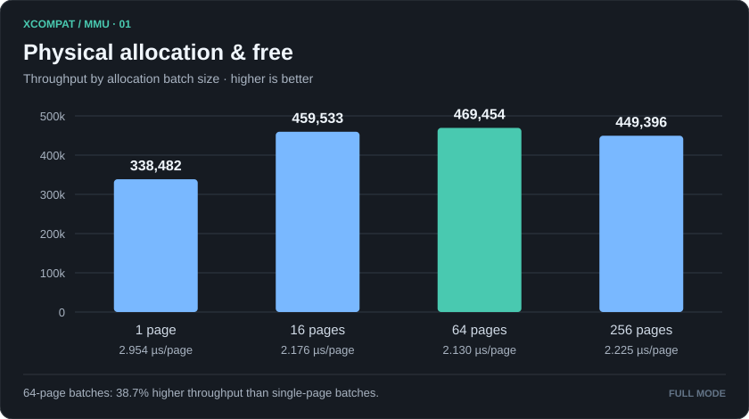
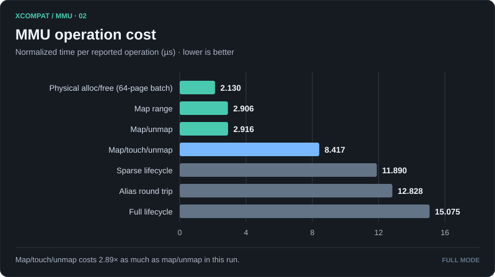
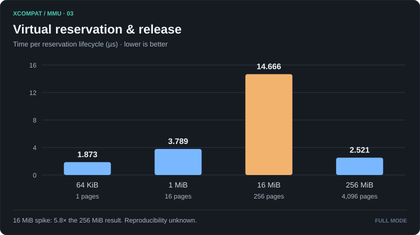
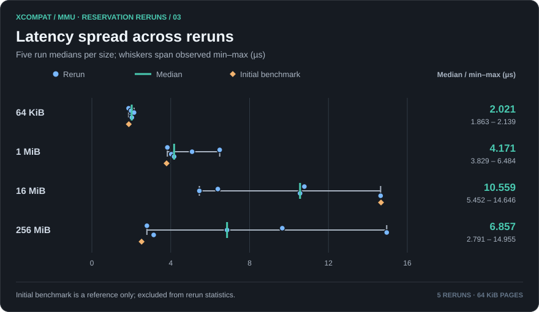
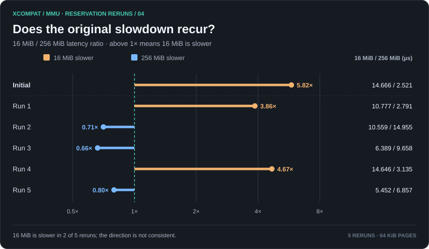
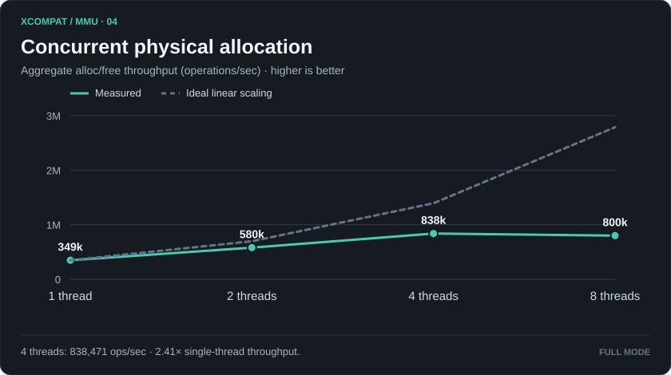
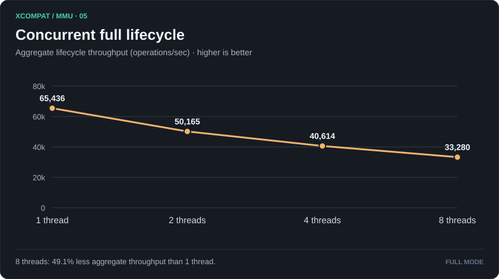
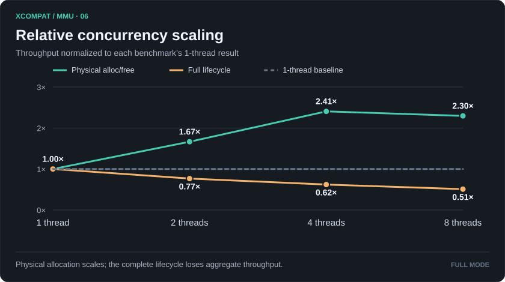

# First MMU Benchmark

Release benchmark on AMD Ryzen 7 7730U, 8 cores/16 threads, 64 KiB pages. Values are medians of seven calibrated samples.

---

## Overview

This benchmark establishes an initial performance baseline for the xcompat kernel MMU (`xcompatkrn`). It measures physical page allocation and freeing, virtual reservation management, page mapping, memory aliasing, complete memory lifecycles, and multithreaded scaling.

All 22 benchmark configurations were run in `full` mode. Results are reported as aggregate operations per second and normalized time per operation. For batched tests, one operation represents one page rather than one entire batch. For concurrent tests, normalized time is calculated from aggregate throughput and should not be interpreted as individual thread latency.

| Metric | Result |
| --- | ---: |
| Peak single-threaded physical allocation/free throughput | 469,454 pages/s |
| Peak concurrent physical allocation/free throughput | 838,471 pages/s |
| Single-page map/unmap | 2.916 µs |
| Contiguous range mapping | 2.906 µs/page |
| Full memory lifecycle | 15.075 µs |
| Full memory lifecycle throughput | 66,337 ops/s |

## Physical page allocation and freeing

| Batch size (pages) | Time/page (µs) | Pages/s |
| ---: | ---: | ---: |
| 1 | 2.954 | 338,482 |
| 16 | 2.176 | 459,533 |
| 64 | 2.130 | 469,454 |
| 256 | 2.225 | 449,396 |

Batching improves physical allocation/free throughput, with the highest measured single-threaded throughput occurring at 64 pages (4 MiB). This configuration is approximately 38.7% faster in throughput than single-page allocation and freeing. Increasing the batch size to 256 pages reduces throughput by approximately 4.3% relative to the 64-page batch.

The results are consistent with batching reducing synchronization overhead. They establish 64 pages as the best-performing tested batch size on this configuration, rather than a universal optimum.

## Mapping and memory lifecycles

| Benchmark | Pages per operation or batch | Time/op (µs) | Ops/s |
| --- | ---: | ---: | ---: |
| Map/unmap | 1 | 2.916 | 342,972 |
| Map/touch/unmap | 1 | 8.417 | 118,801 |
| Range mapping | 16 | 2.906 | 344,066 |
| Alias round trip | 1 | 12.828 | 77,954 |
| Full lifecycle | 1 | 15.075 | 66,337 |
| Sparse lifecycle | 8 | 11.890 | 84,103 |

The normalized cost of contiguous range mapping is within 0.4% of the single-page map/unmap benchmark. Accessing mapped memory increases the measured map/unmap round-trip cost from 2.916 µs to 8.417 µs, or approximately 2.89×. This may reflect demand paging and first-access overhead, although the benchmark does not isolate those costs.

The alias round-trip benchmark measures 12.828 µs per operation. A complete single-page allocation, reservation, mapping, and release lifecycle measures 15.075 µs. The sparse lifecycle benchmark uses eight pages within a 128-page (8 MiB) reservation and reports 11.890 µs per processed page.

## Virtual reservation and release

| Reservation (pages) | Reservation size | Time/op (µs) | Ops/s |
| ---: | ---: | ---: | ---: |
| 1 | 64 KiB | 1.873 | 534,021 |
| 16 | 1 MiB | 3.789 | 263,926 |
| 256 | 16 MiB | 14.666 | 68,186 |
| 4,096 | 256 MiB | 2.521 | 396,643 |

Reservation and release costs are non-monotonic in this initial run. The 16 MiB reservation takes approximately 5.82× as long as the 256 MiB reservation. This was the largest anomaly in the single-threaded results, so it was investigated with isolated reruns before attributing it to either MMU bookkeeping or Windows virtual memory management.

### Isolated reservation reruns

The reservation benchmark was repeated in five independent Release processes. Each reported value is the median of seven calibrated samples. Running the reservation cases separately removes the preceding allocation, mapping, aliasing, and lifecycle benchmarks from the process state.

The 64 KiB result is stable, with a cross-run median of 2.021 µs and an observed range of 1.863–2.139 µs. Larger reservations vary substantially: 1 MiB has a median of 4.171 µs and a range of 3.829–6.484 µs; 16 MiB has a median of 10.559 µs and a range of 5.452–14.646 µs; and 256 MiB has a median of 6.857 µs and a range of 2.791–14.955 µs.

The original 5.82× ratio did not reproduce consistently. The 16 MiB reservation was slower than the 256 MiB reservation in two of five isolated runs. Their cross-run medians differ by 1.54×, and their observed ranges overlap extensively. The initial ratio is therefore a single-process result rather than a stable MMU performance characteristic.

The reruns establish high variance and non-monotonic behavior for larger reservations, but they do not isolate its source. Candidate contributors include native Windows address-space/VAD state and heap allocation for the MMU's per-reservation page and boundary metadata. Future reservation graphs should show individual runs or dispersion alongside medians rather than presenting one median per size as a stable size curve.

## Concurrent physical allocation and freeing

| Threads | Time/op (µs) | Aggregate ops/s | Speedup | Parallel efficiency |
| ---: | ---: | ---: | ---: | ---: |
| 1 | 2.869 | 348,603 | 1.00× | 100.0% |
| 2 | 1.723 | 580,461 | 1.67× | 83.3% |
| 4 | 1.193 | 838,471 | 2.41× | 60.1% |
| 8 | 1.250 | 800,141 | 2.30× | 28.7% |

Physical allocation and freeing scale positively through four threads, reaching 838,471 operations per second, or 2.41× the single-threaded throughput. Eight threads produce approximately 4.6% less throughput than four threads while remaining 2.30× faster than the single-threaded configuration.

The diminishing parallel efficiency indicates that allocation/free scaling is limited beyond four threads on this system. The measurements do not distinguish contention in xcompat's registries from contention in the native NT memory manager.

## Concurrent full lifecycle

| Threads | Time/op (µs) | Aggregate ops/s | Relative throughput |
| ---: | ---: | ---: | ---: |
| 1 | 15.282 | 65,436 | 1.00× |
| 2 | 19.934 | 50,165 | 0.77× |
| 4 | 24.622 | 40,614 | 0.62× |
| 8 | 30.048 | 33,280 | 0.51× |

Unlike physical allocation and freeing in isolation, the complete memory lifecycle exhibits negative scaling. Aggregate throughput falls with each increase in thread count. At eight threads, throughput is approximately 49.1% lower than the single-threaded result.

The MMU currently serializes mapping, unmapping, and reservation release operations through a shared mutex. These operations, together with native NT address-space synchronization, are candidates for profiling. The benchmark establishes the scaling regression but does not identify its cause independently.

## Relative concurrency scaling

The contrasting scaling behavior separates physical backing allocation from the broader virtual memory lifecycle. At four threads, physical allocation/free throughput reaches 2.41× its single-threaded baseline, while full-lifecycle throughput falls to 0.62× its own baseline.

The greatest opportunity for improved concurrent throughput is therefore in the complete memory lifecycle, rather than the isolated physical allocation/free path.

## Conclusion

The initial MMU benchmark establishes single-threaded map/unmap performance at approximately 2.9 µs per operation, with physical allocation/free throughput approaching 470,000 pages per second in 64-page batches. Concurrent physical allocation peaks at approximately 838,000 pages per second with four threads.

The next performance investigation should focus on:

- Measuring mutex wait time and hold time during concurrent lifecycle operations.
- Separating the costs of native reservation, placeholder splitting/coalescing, mapping, and unmapping from MMU bookkeeping.
- Separating native reservation cost from per-reservation metadata allocation to explain the high variance observed for larger reservations.
- Measuring physical backing creation and handle overhead under sustained allocations representative of larger titles.

These results serve as the baseline for subsequent MMU changes. Future comparisons should use the same benchmark mode, hardware, build configuration, and sampling methodology. The available results cover up to eight benchmark threads; all sixteen hardware threads were not tested. Cross-process dispersion is available for the isolated reservation reruns; the other reported medians still have no sample-dispersion or tail-latency measurements.
